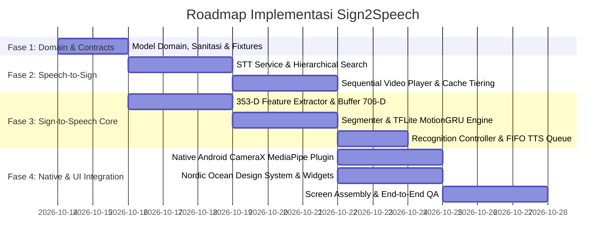

# Product Requirements Document (PRD)
# Sign2Speech: Sistem Komunikasi Dua Arah Aksesibilitas Universal (Sign-to-Speech & Speech-to-Sign)

- **Document ID**: PRD-S2S-2026-001
- **Product Name**: **Sign2Speech**
- **Document Version**: 2.1.0 (Official App Branding: Sign2Speech)
- **Status**: Approved / Ready for Engineering Execution
- **Target Platform**: Flutter (Android-first with Native MediaPipe Holistic CameraX, Extensible to iOS)
- **Author**: Antigravity System Architect & Product Team

---

## 1. Executive Summary & Vision Statement

### 1.1 Visi Produk
**Sign2Speech** hadir untuk meruntuhkan jurang komunikasi antara **Teman Tuli** (pengguna bahasa isyarat BISINDO & SIBI) dan **Teman Dengar** (masyarakat umum, petugas layanan publik, tenaga medis, dan pelaku usaha) melalui teknologi penerjemahan dua arah berbasis kecerdasan buatan (*on-device AI*) yang bekerja secara *real-time*, alami, dan *offline-first*.

### 1.2 Latar Belakang & Problem Statement
Di ruang publik—seperti loket pelayanan kependudukan (Dukcapil), stasiun transportasi, perbankan, fasilitas kesehatan umum, hingga transaksi belanja harian:
1. **Hambatan Teman Tuli**: Menggunakan tulisan manual di catatan HP memakan waktu lama, rawan salah paham konteks emosional, dan sering memicu rasa canggung atau enggan berinteraksi.
2. **Hambatan Teman Dengar / Petugas**: Lebih dari $98\%$ masyarakat dan petugas layanan publik tidak menguasai kosakata isyarat standar, sehingga komunikasi terhenti saat dihadapkan pada situasi kritis atau antrean padat.
3. **Keterbatasan Solusi Eksisting**: Mayoritas aplikasi penerjemah isyarat hanya bekerja satu arah (kamus isyarat statis) atau memerlukan koneksi internet stabil (tidak dapat diandalkan di basement stasiun atau fasilitas minim sinyal).

### 1.3 Solusi Dua Arah Sign2Speech
```
  [TEMAN TULI]                                           [TEMAN DENGAR]
(Bahasa Isyarat)                                         (Suara Lisan)
       │                                                       │
       ▼                                                       ▼
 ┌───────────────┐     Kamera HP (MediaPipe + TFLite)    ┌───────────────┐
 │ SIGN-TO-SPEECH│ ────────────────────────────────────► │  SPEECH / TTS │
 │    MODULE     │         Bahasa Indonesia (id-ID)      │ (Audio Jelas) │
 └───────────────┘                                       └───────────────┘
       ▲                                                       │
       │           Mikrofon HP (STT + Offline Video)           ▼
 ┌───────────────┐ ◄──────────────────────────────────── ┌───────────────┐
 │ VIDEO ISYARAT │                                       │ SPEECH-TO-SIGN│
 │  (Sequential) │                                       │    MODULE     │
 └───────────────┘                                       └───────────────┘
```

---

## 2. Strategic Objectives & Success Metrics (KPIs)

| Kategori KPI | Metrik Target | Definisi Keberhasilan |
| :--- | :--- | :--- |
| **Akurasi Gestur S2S** | $\ge 92\%$ Top-1 Accuracy | Pada gestur tangan & tubuh dalam pencahayaan normal ($\ge 200\text{ lux}$). |
| **Inference Latency S2S** | $\le 45\text{ ms}$ per window | Ekstraksi 353 fitur + inferensi MotionGRU Float16 pada chipset midrange (Helio G99 / Snapdragon 680). |
| **Responsivitas STT S2S** | $\le 800\text{ ms}$ end-to-end | Dari ucapan selesai (`isFinal == true`) hingga video isyarat pertama mulai berputar. |
| **Zero Audio Clash** | $100\%$ Serial FIFO | Tidak ada tumpang-tindih suara kata beruntun saat gestur cepat dilakukan. |
| **Offline Reliability** | $100\%$ Ketersediaan Kosakata Inti | Kosakata darurat, belanja, dan layanan publik dapat diputar tanpa jaringan internet sama sekali. |
| **Frame Rate Kamera** | $\ge 30\text{ FPS}$ konstan | Pratinjau kamera tetap mulus tanpa frame drop saat inferensi berjalan di background thread. |

---

## 3. Target Audience & User Personas

### 3.1 Persona 1: Rian (Teman Tuli, 26 Tahun - Mahasiswa & Pekerja Komuter)
- **Karakteristik**: Penutur asli BISINDO, mandiri, sering bepergian dengan KRL/TransJakarta, berbelanja di minimarket, dan mengurus administrasi publik.
- **Pain Points**: Mengetik di notes HP terasa lambat saat kasir minimarket terburu-buru; sering disalahpahami oleh orang asing.
- **Skenario Penggunaan**:
  1. Rian membuka `SignLanguageScreen` di kasir minimarket.
  2. Rian memperagakan isyarat: *"SAYA MAU BAYAR PAKAI QRIS"*.
  3. Cincin konfirmasi visual berputar mulus memberi haptic feedback, dan suara TTS terdengar jelas ke kasir.
  4. Kasir membalas lewat suara, dan Rian langsung melihat video peragaan isyarat *"TOTALNYA DUA PULUH RIBU"*.

### 3.2 Persona 2: Bu Endang (Petugas Front Office Pelayanan Publik, 45 Tahun)
- **Karakteristik**: Petugas loket layanan kependudukan / perbankan yang ramah namun tidak memahami bahasa isyarat.
- **Pain Points**: Bingung dan panik saat warga tuna rungu datang mengajukan permohonan dokumen; khawatir salah catat data penting.
- **Skenario Penggunaan**:
  1. Bu Endang menekan tombol mikrofon di `TextToSignScreen`.
  2. Bu Endang berbicara santai: *"Silakan tunjukkan KTP asli dan kartu keluarga Anda"*.
  3. Sign2Speech memutar rangkaian video isyarat kata-demi-kata secara berurutan dengan highlight kata aktif, sehingga warga tunarungu langsung memahami berkas apa yang harus diserahkan.

### 3.3 Persona 3: dr. Farhan (Tenaga Medis / UGD Rumah Sakit, 32 Tahun)
- **Karakteristik**: Dokter jaga fasilitas gawat darurat yang membutuhkan penanganan waktu-kritis.
- **Pain Points**: Waktu terbuang mencari juru bahasa isyarat saat pasien tunarungu datang dengan keluhan akut.
- **Skenario Penggunaan**:
  1. Dokter berbicara ke mikrofon: *"Di mana bagian yang terasa sakit dan sejak kapan?"*.
  2. Pasien melihat video isyarat medis darurat yang telah tersimpan offline (Tier 1).
  3. Pasien membalas dengan isyarat tangan ke kamera, dan HP langsung menyuarakan keluhan medis pasien.

---

## 4. Design System Specification: Nordic Ocean & Warm Alabaster

Sistem antarmuka Sign2Speech mengedepankan atmosfer tenang, profesional, dan humanis, menghindari kesan template AI generik berlebihan yang melelahkan mata pengguna disabilitas:

```
┌────────────────────────────────────────────────────────────────────────┐
│                        NORDIC OCEAN PALETTE                            │
│  [#1B3B4B] Mineral Ocean Blue  ── Primary Identity, AppBars, Hero CTA │
│  [#38687D] Fjord Blue          ── Secondary Accent, Rings, Active Wave│
│  [#F9F9F7] Warm Alabaster      ── Canvas Background (Soft Creamy Base)│
│  [#FFFFFF] Pure White          ── Card Surfaces, Bottom Sheets, Modals│
│  [#EAF0F2] Pale Mist           ── Accent Container, Category Chips   │
│  [#192328] Deep Graphite       ── Primary Typography, High Contrast   │
│  [#6B7B83] Stone Slate         ── Secondary Labels, Subtitles, Timers │
└────────────────────────────────────────────────────────────────────────┘
```

### 4.1 Token Desain & Aksesibilitas WCAG 2.1 AAA
- **Rasio Kontras**: Teks Deep Graphite (`#192328`) di atas Warm Alabaster (`#F9F9F7`) mencapai kontras $\mathbf{14.2:1}$ (melampaui standar WCAG AAA minimum $7:1$).
- **Touch Target Ergonomis**: Seluruh elemen tombol aksi memiliki batas tap minimal $48 \times 48\text{ dp}$ dengan padding responsif.
- **HUD Glassmorphism (Camera Overlay)**: Menggunakan blur latar $16\text{ px}$ dengan tint `#1B3B4B` beropasitas $40\%$, menjaga visibilitas feed kamera postur tubuh tanpa distraksi.
- **Hold-to-Confirm Ring**: Cincin indikator ketepatan gestur melingkar beranimasi halus ($0\% \rightarrow 100\%$) dengan aksen Fjord Blue (`#38687D`) dan getaran haptic singkat (*medium impact*) saat gestur terekam.
- **Audio Waveform Visualizer**: 5 batang gelombang reaktif berbasis level desibel suara asli di `SignSpeechCard` memberikan kepastian visual bahwa sistem sedang mendengarkan.

---

## 5. Functional Requirements (FR)

### 5.1 Modul Sign-to-Speech (Kamera $\rightarrow$ MediaPipe $\rightarrow$ MotionGRU $\rightarrow$ Indonesian TTS)

#### FR-S2S-01: Native Landmark Stream Capture
- Mengalirkan 543 koordinat $(x, y, z)$ dari native Android CameraX MediaPipe Holistic melalui `EventChannel('com.sign2speech.bisindo/landmarks')`.
- Alokasi landmark: `Pose: 33` ($99$ float), `Left Hand: 21` ($63$ float), `Right Hand: 21` ($63$ float), `Face Blendshapes: 52` ($52$ float).
- **Edge Case**: Jika frame kamera drop atau terhalang cahaya ekstrem, frame ditandai `isValid = false` tanpa menghentikan streaming pipeline.

#### FR-S2S-02: Strict Numerical Sanitization
- Setiap koordinat wajib melewati pembersihan numerik: setiap nilai `double.nan`, `double.infinity`, atau `-double.infinity` dikonversi menjadi `0.0`.
- Nilai koordinat mentah yang melebihi batas batas fisik tubuh di-clamp ke rentang wajar $[-10.0, 10.0]$.

#### FR-S2S-03: Sign Spotting & Intelligent Segmentation (`BisindoSegmenter`)
- **Onset Detection**: Gestur dianggap dimulai jika kedua tangan atau salah satu tangan terdeteksi muncul stabil selama $\ge 3$ frame berturut-turut dengan energi gerak kinetik (*motion energy*) $\ge E_{\text{thresh}}$.
- **Offset Detection**: Gestur dianggap selesai jika tangan keluar dari frame selama $>450\text{ ms}$ (`endAbsence`) ATAU tangan diam tak bergerak selama $>750\text{ ms}$ (`endStillness`).
- **Durasi Valid**: Hanya sekuens dengan durasi $450\text{ ms} \le t \le 3500\text{ ms}$ yang diteruskan ke classifier. Durasi di bawah $450\text{ ms}$ dibuang sebagai derau (*noise* / gerak reflek).

#### FR-S2S-04: Ekstraksi Fitur 353-Dimensi (`BisindoFeatureExtractor`)
Setiap frame mentah diekstraksi menjadi vektor geometri berukuran tepat 353 float:
- `0..62`: **Left Hand Global** ($21 \times 3$), dinormalisasi terhadap pusat bahu:
  $$P_{\text{global}} = \text{clamp}\left(\frac{P - \text{Center}}{\text{ShoulderDist} + 10^{-6}}, -6.0, 6.0\right)$$
- `63..125`: **Left Hand Local** ($21 \times 3$), dinormalisasi terhadap pergelangan tangan (*wrist*) dan skala telapak (MCP):
  $$P_{\text{local}} = \text{clamp}\left(\frac{P - \text{Wrist}}{\text{PalmScale} + 10^{-6}}, -5.0, 5.0\right)$$
- `126..188`: **Right Hand Global** ($21 \times 3$), formula normalisasi bahu yang sama.
- `189..251`: **Right Hand Local** ($21 \times 3$), formula normalisasi wrist yang sama.
- `252..296`: **15 Landmark Pose Utama** ($15 \times 3 = 45$). Indeks pose: `0, 11..24` (hidung, bahu, siku, pergelangan, pinggul).
- `297..348`: **52 Koefisien Face Blendshapes** MediaPipe (gerak bibir, alis, mata).
- `349..352`: **4 Mask Keberadaan Bagian Tubuh** (`[hasLeftHand, hasRightHand, hasPose, hasFace]`).

#### FR-S2S-05: Temporal Resampling & 706-D Tensor (`BisindoSequenceBuffer`)
- Panjang sekuens $N$ frame dinormalisasi menjadi tepat $T = 48$ timestep temporal melalui interpolasi linier 1D seragam.
- Diferensiasi kecepatan orde pertama dihitung:
  $$\Delta[t] = \text{clamp}(\text{Base}[t] - \text{Base}[t-1], -4.0, 4.0), \quad \Delta[0] = 0$$
- Penggabungan Base ($353$) + Delta Velocity ($353$) membentuk $706$ fitur per timestep.
- Tensor output berukuran tepat $[1, 48, 706]$ tipe data Float32.

#### FR-S2S-06: Dual-Model MotionGRU Classifier (`BisindoClassifierService`)
- Mendukung dua model TFLite Float16 on-device:
  1. **BISINDO Model**: 47 kelas kosakata percakapan umum & layanan publik.
  2. **SIBI Model**: 72 kelas kosakata formal dan alfabet jari.
- **Filter Ambang Keyakinan**:
  - Softmax Confidence $\ge 0.70$.
  - Margin probabilitas peringkat 1 terhadap peringkat 2: $(\text{Top1} - \text{Top2}) \ge 0.15$.
  - Jika tidak memenuhi ambang batas, inferensi dianggap ragu-ragu (*ambiguous*) dan tidak memicu pengucapan suara.

#### FR-S2S-07: Buffer Ejaan Alfabet vs Kosakata Kata Penuh (`BisindoRecognitionController`)
- **Kata Utuh (`WORD_*`)**: Langsung diumpankan ke antrean suara TTS dan ditambahkan ke kalimat transkrip.
- **Huruf Alfabet (`LETTER_*` / A-Z)**:
  - Huruf tidak disuarakan satu per satu agar tidak terdengar patah-patah (*"B... E... L... I"*).
  - Huruf ditampung dalam buffer ejaan visual.
  - Setelah jeda diam $\ge 1500\text{ ms}$ (`letterSpeechIdle`) atau pengguna menekan tombol SPASI pada layar HUD, kata hasil ejaan (*"BELI"*) dibacakan secara utuh sebagai satu kata.
- **Cooldown Duplikat**: Jeda $1200\text{ ms}$ diterapkan untuk mencegah kata yang sama terucap ganda akibat pengulangan gestur tak sengaja.

#### FR-S2S-08: Serial FIFO Indonesian Text-to-Speech (`BisindoTtsService`)
- Output suara Bahasa Indonesia (`id-ID`) menggunakan mesin TTS bawaan perangkat.
- Antrean serial berbasis Future chaining (`_speechChain`): kata-kata berikutnya menunggu giliran secara tertib tanpa saling memotong audio sebelumnya.

#### FR-S2S-09: Transcript History & State Persistence (`SignTranscriptStore`)
- Transkrip disimpan secara lokal via `SharedPreferences`.
- Pengalihan model (BISINDO $\leftrightarrow$ SIBI) atau penjedaan kamera tidak menghapus transkrip kalimat yang telah tersusun.
- Transkrip hanya di-reset saat tombol **Bersihkan / Reset** ditekan secara eksplisit oleh pengguna.

---

### 5.2 Modul Speech-to-Sign (Mikrofon $\rightarrow$ Pencocokan Isyarat $\rightarrow$ Video Playlist)

#### FR-S2S-10: Robust Speech Recognition (`SpeechService`)
- Menggunakan engine STT berbahasa Indonesia (`localeId: 'id'`) dengan mode konfirmasi akurat (`ListenMode.confirmation`).
- Dilindungi token generasi (`_generation: int`) untuk menjamin keselamatan siklus hidup asinkron saat mikrofon dihentikan mendadak.
- Menampilkan visualisasi gelombang suara aktif (*waveform*) secara dinamis pada `SignSpeechCard`.

#### FR-S2S-11: Hands-Free Voice Automation (`TextToSignController`)
- Pengguna cukup menekan tombol rekam satu kali.
- Begitu ucapan selesai terdeteksi (`isFinal == true`), mikrofon otomatis berhenti merekam dan mesin pencarian isyarat langsung memproses teks ucapan tanpa membutuhkan interaksi tombol "Cari" tambahan.

#### FR-S2S-12: Algoritma Pencarian Isyarat Berjenjang (Hierarchical Search)
Pencocokan teks ucapan yang telah dinormalisasi (*lowercase*, tanda baca dibersihkan, spasi ganda dihapus) dilakukan dalam 3 jenjang:
1. **Tier 1: Exact Phrase Match**: Mencocokkan frasa ucapan penuh secara persis dengan label video resmi (contoh: ucapan *"terima kasih"* $\rightarrow$ video *"Terima Kasih"*).
2. **Tier 2: Phrase Alias Match**: Memetakan sinonim dan padanan kata bahasa Indonesia (contoh: ucapan *"tolong"* $\rightarrow$ video *"Bantu"*; ucapan *"karcis"* $\rightarrow$ video *"Tiket"*).
3. **Tier 3: Tokenized Word-by-Word Match**: Memecah kalimat majemuk menjadi deretan kata kunci (contoh: ucapan *"saya mau beli tiket"* $\rightarrow$ deretan video `["Saya", "Mau", "Beli", "Tiket"]`).

#### FR-S2S-13: Sequential Playlist Looping Video Player
- Jika hasil pencarian berupa beberapa kata, video diperagakan satu per satu secara berurutan dan mulus (*seamless playlist*).
- Layar menampilkan deretan chip kata dengan penanda (*highlight badge*) aktif pada kata yang sedang diperagakan.
- Opsi kontrol: Putar Ulang Seluruh Kalimat (*Loop All*), Putar Ulang Kata Tertentu (*Loop Word*), dan Pengaturan Kecepatan Video ($0.75\times$, $1.0\times$, $1.25\times$).
- **Anti-Race Condition Protection (`_playSessionId`)**: Setiap input suara baru menaikkan nomor sesi pemutaran; jika ucapan baru masuk saat video lama sedang dimuat, pemutaran lama segera dibatalkan secara bersih.

#### FR-S2S-14: Resolusi Video Hybrid (Offline Asset, Disk Cache & Remote CDN Hosting)
- **Base CDN Hosting URL**: `https://hajicare-sign.web.app` (dapat dikonfigurasi melalui `SignLanguageConfig`).
- Format endpoint video: `https://hajicare-sign.web.app/videos/{language}/{slug}_v1.mp4` (contoh: `https://hajicare-sign.web.app/videos/bisindo/baik_v1.mp4`).
- **Strategi Resolusi 3-Tier**:
  1. **Tier 1 (Bundled Offline Assets)**: Kosakata inti, darurat, dan frekuensi tinggi (misal: salam, tolong, terima kasih, ya, tidak) dikemas langsung di dalam asset APK (`assets/videos/...`). Langsung diputar dengan $0\text{ ms}$ latensi jaringan tanpa kuota internet.
  2. **Tier 2 (Local Storage Disk Cache)**: Video yang pernah diputar atau diunduh sebelumnya tersimpan di direktori privat aplikasi (`getApplicationSupportDirectory()`).
  3. **Tier 3 (Remote Hosting Stream + Cache-on-Play)**: Video yang belum ada di lokal dialirkan langsung dari CDN hosting `https://hajicare-sign.web.app/videos/...` via `VideoPlayerController.networkUrl`. Bersamaan dengan pemutaran, sistem secara asinkron mengunduh dan menyimpan berkas ke Tier 2 disk cache, sehingga pemutaran berikutnya otomatis offline.

#### FR-S2S-15: Unduhan Kategori Atomik (`downloadCategory`)
- Pengguna dapat mengunduh paket kosakata per kategori (misal: *Layanan Publik*, *Transportasi & Arah*, *Kesehatan Umum*, *Transaksi Harian*).
- Pengunduhan menggunakan Dio dengan penulisan berkas sementara `.tmp` dan mekanisme *atomic rename* ke file `.mp4` asli setelah verifikasi integritas ukuran berkas tuntas, mencegah berkas video korup akibat jaringan terputus.

---

### 5.3 Zero-Lag Camera & On-Device AI Performance Pipeline

Untuk memastikan **kamera pratinjau bergerak mulus ($\ge 30-60\text{ FPS}$) tanpa lag atau patah-patah** saat pengguna memperagakan isyarat:

#### FR-PERF-01: Native CameraX Non-Blocking Background Threading
- **Pemisahan Thread Android**: Image Analysis CameraX tidak boleh berjalan di Main UI Thread Android. Analisis kamera dialokasikan ke `ExecutorService` tunggal terdedikasi (`Executors.newSingleThreadExecutor()`).
- **Strategi Backpressure `STRATEGY_KEEP_ONLY_LATEST`**: Jika MediaPipe Holistic sedang memproses satu frame dan frame kamera baru tiba, CameraX otomatis membuang (*drop*) frame lama dan hanya memproses frame terbaru. Ini mencegah antrean frame menumpuk (*latency drift/lag*).
- **Zero Heavy Allocation**: Struktur memori untuk 543 koordinat didaur ulang (*reused buffer*) di level Kotlin/JNI untuk mencegah lonjakan Garbage Collection (GC) pause.

#### FR-PERF-02: Dart Background Isolate Offloading (`compute` / `Isolate.run`)
- Seluruh komputasi matematika berat di Flutter di-offload dari Main UI Isolate:
  1. Ekstraksi 353 fitur spasial dan normalisasi Euclidean.
  2. Resampling temporal 1D 48-timestep dan diferensiasi kecepatan 706-D.
- Dengan mengisolasi kalkulasi tensor dan inferensi TFLite ke background isolate, Main UI Isolate tetap $100\%$ bebas untuk rendering layar kamera $60\text{ FPS}$, animasi *Hold-to-Confirm Ring*, dan pembaruan transkrip.
- **Frame Throttling & Skip Guard**: Jika kalkulasi window sebelumnya masih berlangsung di background isolate, frame masuk baru hanya memperbarui buffer sirkular tanpa memicu inferensi ganda (*inference debounce/throttle*).

---

## 6. Arsitektur Teknis & Kepatuhan Clean Architecture

Sistem mengikuti pola **Clean Architecture** resmi Flutter dengan pemisahan 3 layer utama dan GetX sebagai orkestrator reaktif:

```
┌─────────────────────────────────────────────────────────────────────────┐
│                           PRESENTATION LAYER                            │
│  ┌────────────────────────────┐       ┌──────────────────────────────┐  │
│  │ SIGN-TO-SPEECH VIEW        │       │ SPEECH-TO-SIGN VIEW          │  │
│  │ SignLanguageScreen         │       │ TextToSignScreen             │  │
│  │ (Camera Preview, HUD Glass,│       │ (SignSpeechCard Waveform,    │  │
│  │  Hold Ring, Spasi & Reset) │       │  Sequential Playlist Player) │  │
│  └──────────────┬─────────────┘       └──────────────┬───────────────┘  │
│                 │                                    │                  │
│  ┌──────────────▼─────────────┐       ┌──────────────▼───────────────┐  │
│  │ VIEWMODELS (GetxController)│       │ VIEWMODEL (GetxController)   │  │
│  │ - SignLanguageController   │       │ - TextToSignController       │  │
│  │ - BisindoRecognitionCtrl   │       │   (STT Orchestrator,         │  │
│  │   (Hold Ring, FIFO TTS)    │       │    Playlist & Session Guard) │  │
│  └──────────────┬─────────────┘       └──────────────┬───────────────┘  │
└─────────────────┼────────────────────────────────────┼──────────────────┘
                  │                                    │
┌─────────────────┼────────────────────────────────────┼──────────────────┐
│                 ▼             DOMAIN LAYER           ▼                  │
│  ┌────────────────────────────┐       ┌──────────────────────────────┐  │
│  │ Entities & Value Objects:  │       │ Entities & Value Objects:    │  │
│  │ - LandmarkFrame (543 pts)  │       │ - SignVideoEntry             │  │
│  │ - BisindoPrediction        │       │ - SignSearchResult          │  │
│  │ - SignToken (Word/Letter)  │       │ - SignLanguageCatalog        │  │
│  │ - SignCaptureQuality       │       │ - CategoryPackageInfo        │  │
│  └────────────────────────────┘       └──────────────────────────────┘  │
└─────────────────┼────────────────────────────────────┼──────────────────┐
                  │                                    │
┌─────────────────┼────────────────────────────────────┼──────────────────┐
│                 ▼              DATA LAYER            ▼                  │
│  ┌────────────────────────────┐       ┌──────────────────────────────┐  │
│  │ Sign-to-Speech Engine:     │       │ Speech-to-Sign Engine:       │  │
│  │ - ICameraLandmarkService   │       │ - SpeechService (STT id)     │  │
│  │   (BisindoCameraLandmark   │       │ - SignLanguageRepository     │  │
│  │    & MockLandmarkService)  │       │   (Hierarchical Matcher)     │  │
│  │ - BisindoFeatureExtractor  │       │ - SignLanguageCacheService   │  │
│  │ - BisindoSequenceBuffer    │       │ - SignLanguageAssetRegistry  │  │
│  │ - BisindoClassifierService │       │ - VideoPlayerController      │  │
│  │ - BisindoSegmenter         │       │ - Atomic Dio Category Downl. │  │
│  │ - BisindoTtsService (TTS)  │       │                              │  │
│  │ - SignTranscriptStore      │       │                              │  │
│  └────────────────────────────┘       └──────────────────────────────┘  │
└─────────────────────────────────────────────────────────────────────────┘
```

### Prinsip Kepatuhan Kode:
1. **Controller Bebas BuildContext**: Seluruh controller GetX tidak menerima atau menyimpan referensi `BuildContext`.
2. **Interface Abstraction & High Testability**: Layanan kamera diikat melalui `ICameraLandmarkService` dan model diikat melalui `IModelClassifier`, memungkinkan pengujian TDD unit test instan menggunakan data sintetis tanpa membutuhkan perangkat keras kamera fisik.
3. **Single Source of Truth (SSOT)**: Seluruh katalog video isyarat dikelola tunggal oleh `SignLanguageRepository`, dan seluruh status transkrip dikelola oleh `BisindoRecognitionController`.
4. **Lifecycle & Memory Management**: Semua stream controller, timer idle ejaan, dan pemutar video di-dispose secara ketat pada `onClose()`.

---

## 7. Keamanan, Privasi & Kepatuhan Data (Privacy-by-Design)

- **On-Device Local Processing**: Seluruh pemrosesan citra kamera, ekstraksi landmark, dan inferensi AI berjalan $100\%$ lokal di memori perangkat pengguna (*on-device*). Tidak ada frame kamera, video pengguna, atau data biometrik wajah yang dikirimkan ke jaringan internet atau disimpan permanen ke disk.
- **Kepatuhan Privasi (UU PDP Indonesia)**: Tangkapan suara STT hanya digunakan sementara untuk resolusi teks saat tombol mikrofon ditekan dan langsung dibuang setelah pencarian video selesai.
- **Izin Minimal**: Hanya meminta izin `CAMERA` dan `RECORD_AUDIO` saat layar fitur terkait dibuka, dilengkapi penjelasan transparansi aksesibilitas kepada pengguna.

---

## 8. Rencana Rilis & Milestone Pengembangan



Dokumen ini menjadi acuan mutlak (*Single Source of Truth*) untuk penyusunan **Implementation Plan** teknis di [docs/superpowers/plans/2026-10-13-sign-and-speech-plan.md](file:///c:/fadli/Antigravity-Skill-Brain/docs/superpowers/plans/2026-10-13-sign-and-speech-plan.md).
