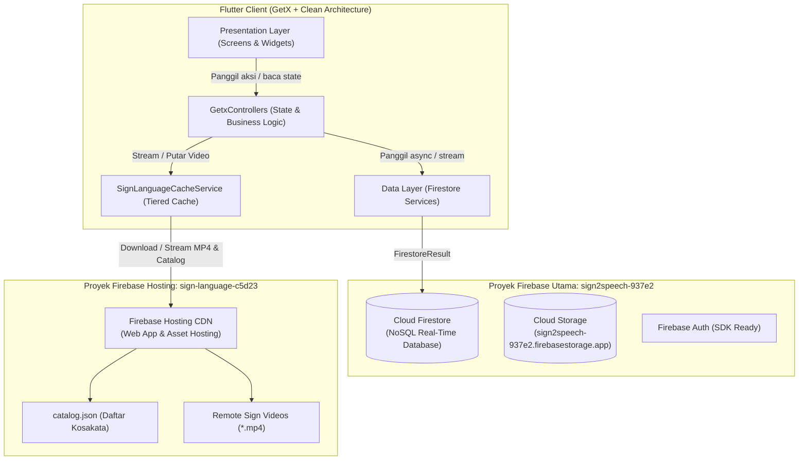
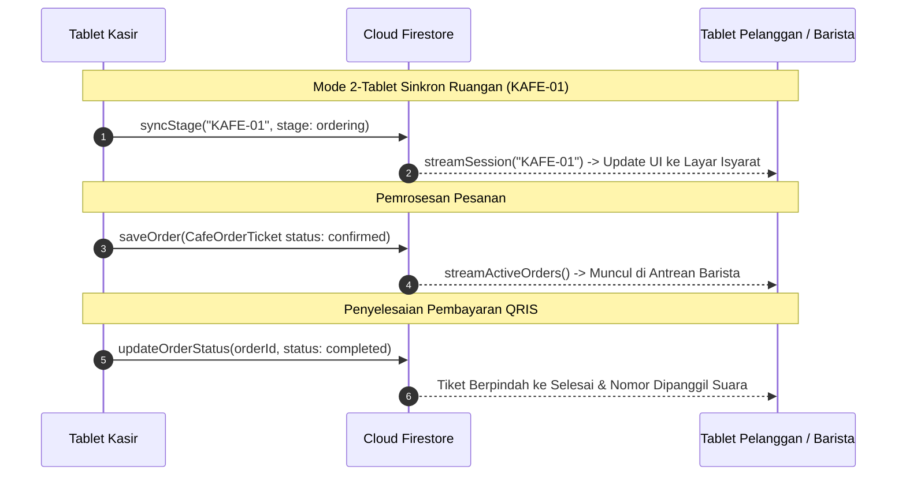

# Arsitektur & Analisa Penggunaan Firebase - Sign2Speech

Dokumen ini adalah dokumentasi teknis resmi dan analisa komprehensif mengenai seluruh arsitektur, konfigurasi lingkungan, pemodelan data, integrasi kode, dan audit keamanan **Firebase** pada aplikasi **Sign2Speech** (`speech2sign`).

---

## 1. Ringkasan Eksekutif & Topologi Sistem

Aplikasi **Sign2Speech** menggunakan arsitektur hybrid yang menghubungkan aplikasi Flutter dengan dua proyek Firebase terpisah untuk mengoptimalkan pemisahan beban komputasi/database dan distribusi aset media:



### 1.1 Spesifikasi Lingkungan Proyek

| Parameter | Proyek Utama (Data & Backend) | Proyek Sekunder (Hosting & CDN) |
| :--- | :--- | :--- |
| **Project ID** | `sign2speech-937e2` | `sign-language-c5d23` |
| **Project Number** | `758641728613` | - |
| **Layanan Aktif** | Cloud Firestore, Cloud Storage, Firebase Core | Firebase Hosting (Global CDN) |
| **File Konfigurasi** | [`lib/firebase_options.dart`](file:///c:/fadli/project/sign2speech/lib/firebase_options.dart)<br>[`android/app/google-services.json`](file:///c:/fadli/project/sign2speech/android/app/google-services.json) | [`lib/core/constants/app_constants.dart`](file:///c:/fadli/project/sign2speech/lib/core/constants/app_constants.dart) |
| **Target URL** | `https://sign2speech-937e2.firebaseio.com` | `https://sign-language-c5d23.web.app`<br>`https://sign-language-c5d23.firebaseapp.com` |
| **Paket SDK (`pubspec.yaml`)** | `firebase_core: ^5.1.0`<br>`cloud_firestore: ^7.1.0`<br>`firebase_auth: ^7.0.1` | Menggunakan HTTP Client (`dio: ^5.11.1`) dengan tiered cache |

---

## 2. Inisialisasi & Ketahanan Sistem (Lifecycle & Defensive Init)

### 2.1 Inisialisasi Aplikasi ([`lib/main.dart`](file:///c:/fadli/project/sign2speech/lib/main.dart))
Inisialisasi Firebase dilakukan di tahap *bootstrap* aplikasi sebelum antarmuka dijalankan:
```dart
void main() async {
  WidgetsFlutterBinding.ensureInitialized();

  // Inisialisasi Cloud Services Firebase dengan penanganan aman (non-blocking)
  try {
    await Firebase.initializeApp(
      options: DefaultFirebaseOptions.currentPlatform,
    );
  } catch (e) {
    debugPrint('Firebase initialization notice: $e');
  }

  // Load preferensi pengguna (bahasa & tema AMOLED) sebelum runApp
  ...
  runApp(const Speech2SignApp());
}
```
> [!NOTE]
> Jika koneksi internet mati atau aplikasi dijalankan pada platform non-Android (seperti desktop runner atau test runner), blok `try-catch` mencegah aplikasi mengalami *hard crash*, dan seluruh fungsi lokal tetap berjalan secara offline.

### 2.2 Pola Inisialisasi Defensif (Defensive Lazy Getter)
Seluruh service Firestore di Data Layer menerapkan pola **defensive lazy initialization** agar tidak melempar eksepsi `[core/no-app]` ketika dijalankan dalam *headless widget test* atau *unit test*:
```dart
class FirestoreServiceExample {
  final FirebaseFirestore? _customFirestore;

  FirestoreServiceExample({FirebaseFirestore? firestore})
      : _customFirestore = firestore;

  FirebaseFirestore? get _firestore {
    if (_customFirestore != null) return _customFirestore;
    try {
      return FirebaseFirestore.instance;
    } catch (_) {
      return null;
    }
  }
}
```
Ketika `_firestore` bernilai `null`, service mengembalikan `FirestoreFailure('FirebaseFirestore is not initialized')` atau `Stream.value([])` secara aman tanpa merusak eksekusi test suite.

---

## 3. Penerapan Clean Architecture & State Modeling

Proyek menerapkan aturan resmi dari [`.agents/rules/firebase-development-rules.md`](file:///c:/fadli/project/sign2speech/.agents/rules/firebase-development-rules.md):

```
┌─────────────────────────────────────────────────────────────────┐
│ Presentation Layer (Views & Widgets)                            │
│ Dilarang keras mengimpor cloud_firestore atau firebase_auth     │
└─────────────────────────────────▲───────────────────────────────┘
                                  │ Mengamati State (Rx/Obx)
┌─────────────────────────────────┴───────────────────────────────┐
│ Logic / Presentation Layer (GetxControllers)                    │
│ CafeCashierController, HistoryController, SettingsController    │
└─────────────────────────────────▲───────────────────────────────┘
                                  │ Memanggil Service (FirestoreResult<T>)
┌─────────────────────────────────┴───────────────────────────────┐
│ Data Layer (Datasources & Services)                             │
│ FirestoreCafePosService, FirestoreCounterSessionService, dll.   │
└─────────────────────────────────▲───────────────────────────────┘
                                  │ REST / gRPC SDK Call
┌─────────────────────────────────┴───────────────────────────────┐
│ Google Cloud Firestore Backend                                  │
└─────────────────────────────────────────────────────────────────┘
```

### 3.1 Pemodelan Status Operasi (Dart 3 `sealed class`)
File [`lib/core/firebase/firestore_result.dart`](file:///c:/fadli/project/sign2speech/lib/core/firebase/firestore_result.dart) mendefinisikan *algebraic data type* untuk seluruh respon Firestore:
```dart
sealed class FirestoreResult<T> {
  const FirestoreResult();
}

final class FirestoreSuccess<T> extends FirestoreResult<T> {
  final T data;
  const FirestoreSuccess(this.data);
}

final class FirestoreFailure<T> extends FirestoreResult<T> {
  final String errorMessage;
  final Object? error;
  const FirestoreFailure(this.errorMessage, [this.error]);
}
```

### 3.2 Penanganan di Controller dengan Pattern Matching
Setiap respon ditangani dengan *exhaustive pattern matching* tanpa *silent fallback*:
```dart
final result = await _firestoreService.saveOrder(ticket);
switch (result) {
  case FirestoreSuccess(:final data):
    debugPrint('Order saved successfully: $data');
  case FirestoreFailure(:final errorMessage):
    debugPrint('Firestore save failed: $errorMessage');
}
```

### 3.3 Dependency Injection Terpusat ([`lib/presentation/navigation/app_binding.dart`](file:///c:/fadli/project/sign2speech/lib/presentation/navigation/app_binding.dart))
Seluruh service Firestore didaftarkan secara permanen saat aplikasi dimulai:
- `Get.put<FirestoreHistoryService>(FirestoreHistoryService(), permanent: true)`
- `Get.put<FirestoreSettingsService>(FirestoreSettingsService(), permanent: true)`
- `Get.put<FirestoreCafePosService>(FirestoreCafePosService(), permanent: true)`
- `Get.put<FirestoreTranscriptService>(FirestoreTranscriptService(), permanent: true)`
- `Get.lazyPut<FirestoreCounterSessionService>(() => FirestoreCounterSessionService())`

---

## 4. Struktur Koleksi Data Cloud Firestore

Terdapat **6 koleksi utama** dan **1 probe kesehatan** dalam database Firestore:

### 4.1 Koleksi `cafe_orders` (Pesanan Meja Kasir Kafe)
- **Service Penanggung Jawab:** [`FirestoreCafePosService`](file:///c:/fadli/project/sign2speech/lib/features/cafe_pos/data/datasources/firestore_cafe_pos_service.dart)
- **Controller Terkait:** [`CafeCashierController`](file:///c:/fadli/project/sign2speech/lib/features/cafe_pos/controllers/cafe_cashier_controller.dart)
- **Path Dokumen:** `/cafe_orders/{orderId}` (Contoh: `ORD-1730000000000`)
- **Skema Dokumen:**

| Field | Tipe Data | Wajib? | Keterangan |
| :--- | :--- | :--- | :--- |
| `orderId` | `string` | Ya | ID unik pesanan (maks. 100 karakter). |
| `queueNumber` | `string` | Ya | Nomor antrean pelanggan (misal: `A-01`, `B-12`). |
| `customerName` | `string` | Ya | Nama pelanggan pada cup kopi (maks. 100 karakter). |
| `customerNotes` | `string` | Tidak | Catatan khusus (misal: alergi susu sapi, less sugar). |
| `items` | `list<map>` | Ya | Daftar minuman yang dipesan (maks. 50 item). |
| `status` | `string` | Ya | Enum: `draft`, `confirmed`, `preparing`, `ready`, `completed`, `cancelled`. |
| `paymentMethod` | `string` | Ya | Enum: `qris`, `cash`, `debitCard`, `creditCard`, `eWallet`. |
| `amountPaid` | `int` | Ya | Jumlah nominal pembayaran (dalam Rupiah). |
| `subtotal` | `int` | Ya | Total harga sebelum pajak. |
| `taxAmount` | `int` | Ya | Nilai PPN (10%). |
| `grandTotal` | `int` | Ya | Total keseluruhan yang harus dibayar. |
| `changeAmount` | `int` | Ya | Uang kembalian pelanggan. |
| `createdAt` | `timestamp` | Ya | Waktu pesanan dibuat (`FieldValue.serverTimestamp()`). |
| `updatedAt` | `timestamp` | Ya | Waktu terakhir pesanan diubah statusnya. |

### 4.2 Koleksi `counter_sessions` (Sinkronisasi Dual-Tablet Meja Kasir)
- **Service Penanggung Jawab:** [`FirestoreCounterSessionService`](file:///c:/fadli/project/sign2speech/lib/features/cafe_pos/data/datasources/firestore_counter_session_service.dart)
- **Controller Terkait:** [`CafeCashierController`](file:///c:/fadli/project/sign2speech/lib/features/cafe_pos/controllers/cafe_cashier_controller.dart)
- **Path Dokumen:** `/counter_sessions/{counterId}` (Contoh: `KAFE-01`)
- **Fungsi Khusus:** Menghubungkan Tablet 1 (Kasir) dan Tablet 2 (Pelanggan) agar berganti layar secara sinkron secara real-time tanpa delay.
- **Skema Dokumen:**

| Field | Tipe Data | Wajib? | Keterangan |
| :--- | :--- | :--- | :--- |
| `counterId` | `string` | Ya | Kode ruangan meja kasir (misal: `KAFE-01`). |
| `stage` | `string` | Ya | Tahap aktif alur: `ordering`, `naming`, `pickup`. |
| `deviceMode` | `string` | Tidak | Mode perangkat: `singleTablet`, `dualTablet`. |
| `currentOrderId` | `string` | Tidak | ID tiket pesanan aktif yang sedang diproses di meja. |
| `cashierTabletId`| `string` | Tidak | Identifier unik tablet kasir yang memasukkan PIN staf. |
| `customerTabletId`| `string` | Tidak | Identifier unik tablet hadap pelanggan. |
| `updatedAt` | `timestamp` | Ya | Timestamp sinkronisasi terakhir. |

### 4.3 Koleksi `translations_history` (Riwayat Terjemahan Isyarat & Suara)
- **Service Penanggung Jawab:** [`FirestoreHistoryService`](file:///c:/fadli/project/sign2speech/lib/features/history/services/firestore_history_service.dart)
- **Controller Terkait:** [`HistoryController`](file:///c:/fadli/project/sign2speech/lib/features/history/controllers/history_controller.dart)
- **Path Dokumen:** `/translations_history/{historyId}`
- **Skema Dokumen:**

| Field | Tipe Data | Wajib? | Keterangan |
| :--- | :--- | :--- | :--- |
| `id` | `string` | Ya | ID riwayat unik. |
| `originalContent` | `string` | Ya | Teks asal / kata isyarat terdeteksi (maks. 1000 karakter). |
| `translatedContent` | `string`| Ya | Hasil terjemahan suara / video isyarat (maks. 1000 karakter). |
| `direction` | `string` | Ya | Arah terjemahan: `signToSpeech` atau `speechToSign`. |
| `signLanguageType`| `string` | Ya | Bahasa isyarat yang digunakan: `BISINDO` atau `SIBI`. |
| `timestamp` | `string` | Ya | Format ISO-8601 string untuk pengurutan lokal. |
| `createdAt` | `timestamp` | Ya | Server timestamp resmi Firestore. |

### 4.4 Koleksi `user_settings` (Sinkronisasi Cloud Preferensi Pengguna)
- **Service Penanggung Jawab:** [`FirestoreSettingsService`](file:///c:/fadli/project/sign2speech/lib/features/settings/services/firestore_settings_service.dart)
- **Controller Terkait:** [`SettingsController`](file:///c:/fadli/project/sign2speech/lib/features/settings/controllers/settings_controller.dart)
- **Path Dokumen:** `/user_settings/{userId}` (Default: `/user_settings/default_user`)
- **Skema Dokumen:**

| Field | Tipe Data | Nilai yang Diizinkan | Keterangan |
| :--- | :--- | :--- | :--- |
| `userId` | `string` | `default_user` / UID | Identitas pengguna. |
| `role` | `string` | `deaf`, `hearing`, `cashier` | Peran pengguna aplikasi. |
| `signLanguage` | `string` | `BISINDO`, `SIBI` | Bahasa isyarat pilihan. |
| `appLanguage` | `string` | `id`, `en` | Bahasa antarmuka aplikasi. |
| `themeMode` | `string` | `system`, `light`, `dark` | Pengaturan mode tema visual. |
| `ttsSpeed` | `number` | `0.25` s/d `3.0` | Kecepatan audio Text-To-Speech. |
| `videoSpeed` | `number` | `0.25` s/d `3.0` | Kecepatan pemutaran kamus video. |
| `hasCompletedOnboarding` | `bool` | `true`, `false` | Status penyelesaian layar onboarding. |
| `updatedAt` | `timestamp`| Server timestamp | Waktu terakhir pengaturan diubah. |

### 4.5 Koleksi `sign_transcripts` (Arsip Transkripsi Gerak Isyarat)
- **Service Penanggung Jawab:** [`FirestoreTranscriptService`](file:///c:/fadli/project/sign2speech/lib/features/sign_language/services/firestore_transcript_service.dart)
- **Path Dokumen:** `/sign_transcripts/{transcriptId}`
- **Fungsi:** Mengarsipkan token mentah deteksi model MotionGRU beserta waktu deteksi per token ke cloud guna menghemat kapasitas penyimpanan internal smartphone.
- **Skema:** `sessionId`, `tokens` (list of `SignToken`), `fullSentence`, `tokenCount`, `languageType` (`BISINDO`/`SIBI`), `createdAt`.

### 4.6 Koleksi `user_loyalty` (Poin Stempel Pelanggan)
- **Service Penanggung Jawab:** [`FirestoreCafePosService`](file:///c:/fadli/project/sign2speech/lib/features/cafe_pos/data/datasources/firestore_cafe_pos_service.dart)
- **Path Dokumen:** `/user_loyalty/{customerId}`
- **Skema:** `customerId` (string), `stampsCount` (integer $\ge 0$), `updatedAt` (timestamp).

### 4.7 Koleksi `test_connection` (Health Check Probe)
- **Path Dokumen:** `/test_connection/mvp_init_test` atau `/test_connection/flutter_client_probe`
- **Fungsi:** Memverifikasi latensi dan status keterhubungan Firestore dari aplikasi.

---

## 5. Alur Data Realtime (Streams vs One-Shot Queries)

Aplikasi memanfaatkan kapabilitas sinkronisasi instan Firestore untuk beberapa fitur utama:



| Nama Metode Stream | Koleksi Target | Penerima Pembaruan | Optimasi Query |
| :--- | :--- | :--- | :--- |
| `streamSession(counterId)` | `counter_sessions` | Tablet Pelanggan | `doc(counterId).snapshots()` (1 dokumen, hemat kuota). |
| `streamActiveOrders()` | `cafe_orders` | Layar Antrean Barista & Kasir | `whereIn: ['draft', 'confirmed', 'preparing', 'ready']`<br>*Sorting dilakukan di memori (in-memory sort) untuk menghindari kebutuhan composite index berat.* |
| `watchHistory(limit: 30)` | `translations_history` | Tab Riwayat | `orderBy('timestamp', descending: true).limit(limit)`. |
| `streamSettings(userId)` | `user_settings` | Pengaturan Realtime | `doc(userId).snapshots()`. |

---

## 6. Audit Keamanan & Analisa Celah (`firestore.rules`)

File [`firestore.rules`](file:///c:/fadli/project/sign2speech/firestore.rules) telah dianalisa secara menyeluruh. Berikut adalah temuan dan status keamanannya:

### 6.1 Arsitektur Default Deny
Aturan diatur dengan prinsip *least-privilege* dan menolak semua dokumen yang tidak terdaftar:
```javascript
service cloud.firestore {
  match /databases/{database}/documents {
    match /{document=**} {
      allow read, write: if false;
    }
    ...
  }
}
```

### 6.2 Celah Kritis yang Ditemukan (Critical Gap)
> [!WARNING]
> **Koleksi `counter_sessions` Belum Didaftarkan dalam `firestore.rules`!**
> Service [`FirestoreCounterSessionService`](file:///c:/fadli/project/sign2speech/lib/features/cafe_pos/data/datasources/firestore_counter_session_service.dart) melakukan operasi tulis dan *stream* pada koleksi `/counter_sessions/{counterId}`. Namun, aturan untuk koleksi ini **belum dituliskan** di `firestore.rules`.
> **Dampak:** Karena aturan default deny aktif, operasi sinkronisasi 2 tablet meja kasir akan diblokir dengan pesan error `permission-denied` saat diterapkan di Firebase production.

#### Solusi Perbaikan Aturan (`firestore.rules`):
```javascript
    // ── Validation: Dual-Tablet Counter Sessions ─────────────────
    function isValidCounterSession(data) {
      return data.counterId is string
          && data.counterId.size() <= 50
          && (!('stage' in data) || data.stage in ['ordering', 'naming', 'pickup'])
          && (!('deviceMode' in data) || data.deviceMode in ['singleTablet', 'dualTablet'])
          && (!('currentOrderId' in data) || (data.currentOrderId is string && data.currentOrderId.size() <= 100));
    }

    match /counter_sessions/{counterId} {
      allow read: if true;
      allow create, update: if isValidCounterSession(request.resource.data);
      allow delete: if true;
    }
```

### 6.3 Analisa Autentikasi Pengguna (`firebase_auth`)
- **Status Saat Ini:** Dependensi `firebase_auth: ^7.0.1` terpasang di `pubspec.yaml`, tetapi saat ini aplikasi beroperasi secara publik/anonim tanpa alur login pengguna.
- **Dampak pada Rules:** Hak baca/tulis riwayat dan pesanan saat ini menggunakan `allow read: if true;` yang dipagari oleh **validasi skema ketat** (`isValidHistory`, `isValidCafeOrder`, dll.) untuk mencegah korupsi data.
- **Rekomendasi Tahap Berikutnya:** Mengaktifkan Firebase Anonymous Authentication (`FirebaseAuth.instance.signInAnonymously()`) pada saat start aplikasi, sehingga aturan `request.auth != null` dapat ditegakkan secara menyeluruh tanpa mengganggu pengalaman pengguna yang tidak ingin mendaftar akun.

---

## 7. Rangkuman Pengujian Otomatis (Automated Tests)

Integrasi Firebase telah diuji secara komprehensif dalam test suite aplikasi. Seluruh pengujian berjalan 100% lulus tanpa memerlukan koneksi emulator backend eksternal:

| Test Suite File | Komponen yang Diuji | Status |
| :--- | :--- | :--- |
| [`test/features/cafe_pos/firestore_cafe_pos_service_test.dart`](file:///c:/fadli/project/sign2speech/test/features/cafe_pos/firestore_cafe_pos_service_test.dart) | Operasi `saveOrder`, `updateOrderStatus`, `syncLoyaltyStamps`, serialisasi tiket, dan penanganan `FirestoreFailure` saat uninitialized. | ✅ Passed |
| [`test/features/history/firestore_history_service_test.dart`](file:///c:/fadli/project/sign2speech/test/features/history/firestore_history_service_test.dart) | Operasi simpan, ambil, dan hapus riwayat terjemahan. | ✅ Passed |
| [`test/features/settings/firestore_settings_service_test.dart`](file:///c:/fadli/project/sign2speech/test/features/settings/firestore_settings_service_test.dart) | Operasi simpan dan ambil preferensi pengguna ke cloud. | ✅ Passed |
| [`test/features/sign_language/firestore_transcript_service_test.dart`](file:///c:/fadli/project/sign2speech/test/features/sign_language/firestore_transcript_service_test.dart) | Pengarsipan token MotionGRU ke koleksi transkrip. | ✅ Passed |

---

## 8. Panduan Perintah CLI Firebase

Berdasarkan skill `firebase-basics` dan `firestore-rules-creation`, berikut perintah kerja standar untuk pemeliharaan Firebase di proyek ini:

```bash
# 1. Pastikan mengarah ke proyek yang benar
firebase use sign2speech-937e2

# 2. Validasi & Deploy Security Rules Firestore
firebase deploy --only firestore:rules --project sign2speech-937e2

# 3. Validasi & Deploy Index Firestore
firebase deploy --only firestore:indexes --project sign2speech-937e2

# 4. Menjalankan Emulator Lokal untuk Pengujian Integrasi
firebase emulators:start --only firestore
```
