# 📋 Dokumen Rencana Migrasi & Modernisasi: Proyek Sign2Speech

> **Status:** Selesai Terverifikasi (*Completed & Verified 100%*)  
> **Tanggal:** 17 November 2026  
> **Target SDK:** Flutter 3.50.0 • Dart 3.14.0  

---

## 1. Status Lingkungan (*Environment Status*) Saat Ini

Melalui eksekusi perintah modernisasi, environment proyek telah berhasil ditingkatkan ke versi mutakhir:

1. **Flutter SDK:** Telah di-upgrade ke **Flutter 3.50.0** (Channel `stable`, engine hash `bf601093ad255aaf5c6d0fc5c4f9acfa60943b2a`).
2. **Dart SDK:** Telah diperbarui ke **Dart 3.14.0** (Host: `windows_x64`).
3. **Dependensi Pub (`pubspec.yaml` & `pubspec.lock`):** Telah menjalankan `flutter pub upgrade` dengan 21 paket berhasil diperbarui ke kompatibilitas SDK terbaru (`archive 4.7.1`, `code_assets 2.2.0`, `hooks 2.2.0`, `jni 1.1.2`, `record_use 1.1.1`, `shared_preferences_android 2.5.5`, `video_player_android 2.12.4`, `web 1.1.2`, dll.).
4. **Konfigurasi MCP Server (`.agents/mcp_config.json`):**
   - `dart` MCP Server (`command: dart`, `args: ["mcp-server"]`) aktif.
   - `developerKnowledge` MCP Server (`url: https://developerknowledge.googleapis.com/mcp`) aktif.
   - `context7` MCP Server aktif.
5. **Agent Skills Terinstal:**
   - 25 skills terverifikasi dari `flutter/agent-plugins` (`flutter-apply-architecture-best-practices`, `flutter-build-responsive-layout`, `dart-run-static-analysis`, dll.).
   - 15 skills terverifikasi dari `dart-lang/skills` (`dart-use-pattern-matching`, `dart-setup-ffi-assets`, `dart-use-primary-constructors`, `dart-add-unit-test`, dll.).

---

## 2. Pemetaan Area Kode yang Perlu Di-Refactor

Berdasarkan audit menyeluruh terhadap arsitektur `lib/` saat ini, berikut adalah pemetaan area refactoring:

```mermaid
flowchart TD
    A["Proyek Sign2Speech (Flutter 3.50 / Dart 3.14)"] --> B["Area A: Sintaks Modern Dart 3.14"]
    A --> C["Area B: Pipeline Kamera & MediaPipe Vision"]
    A --> D["Area C: AI Cerdas & Translasi (Genkit)"]
    A --> E["Area D: Kesiapan WebAssembly (Wasm)"]
    A --> F["Area E: Sanitasi Analyzer & Deprecations"]

    B --> B1["Dot Shorthands (.center, .none, .zero)"]
    B --> B2["Dart 3 Pattern Matching & Switch Expressions"]
    B --> B3["Sealed Classes untuk State Modeling"]

    C --> C1["flutter-mediapipe (mediapipe_vision / mediapipe_core)"]
    C --> C2["Dart Native Assets Build Hooks (hook/build.dart)"]
    C --> C3["Mandatory .dispose() di onClose() GetxController"]

    D --> D1["ai.defineFlow untuk Normalisasi Kalimat Kafe"]
    D --> D2["@Schema() Validasi Input/Output Translasi"]

    E --> E1["Audit bebas dart:html & dart:js"]
    E --> E2["Adopsi package:web & dart:js_interop"]
    E --> E3["Flag Build --web-content-hash"]

    F --> F1["Pembersihan Peringatan Deprecated Member"]
    F --> F2["Pencapaian 0 Error & 0 Warning dart analyze"]
```



---

### Area A: Refactoring Sintaks Modern Dart 3.14

| Lokasi File / Modul | Pola Saat Ini | Rekomendasi Modernisasi Dart 3.14 |
| :--- | :--- | :--- |
| `lib/features/cafe_pos/controllers/cafe_cashier_controller.dart` | Penggunaan `switch-case` konvensional dengan banyak `break` pada routing status pesanan dan modal kamera. | Ubah ke **Dart 3 Switch Expressions** yang ringkas, immutable, dan exhaustive. |
| `lib/presentation/widgets/pagination_control_bar.dart` & Widget UI | Penulisan eksplisit `MainAxisAlignment.center`, `TextAlign.center`, `BorderRadius.zero`. | Terapkan **Dot Shorthands** (`.center`, `.zero`) di titik-titik yang tipe targetnya telah inferable oleh Dart 3.14. |
| `lib/core/supabase/supabase_result.dart` | `abstract class SupabaseResult<T>` dengan subclass manual. | Refactor ke **`sealed class SupabaseResult<T>`** murni untuk menjamin exhaustive pattern matching di seluruh controller pemanggil. |
| `lib/features/cafe_pos/domain/models/cafe_order.dart` | Getter dan factory deserialization dengan pengecekan manual. | Manfaatkan **Pattern Matching & Object Destructuring** (`case {'id': int id, 'name': String name}`) untuk parsing JSON yang aman dan tanpa runtime crash. |

---

### Area B: Pipeline Kamera, MediaPipe & Machine Learning

| Lokasi File / Modul | Pola Saat Ini | Rekomendasi Modernisasi |
| :--- | :--- | :--- |
| `lib/features/sign_language/services/camera_feed_service.dart` | Menggunakan custom Android `CameraX` `MethodChannel` & `EventChannel`. | Siapkan arsitektur transisi ke **`flutter-mediapipe` (`mediapipe_vision` & `mediapipe_core`)** yang memanfaatkan **Dart Native Assets Build Hooks** (`hook/build.dart`) untuk performa C++ native interop langsung tanpa overhead serialization platform channel. |
| `lib/features/cafe_pos/controllers/cafe_cashier_controller.dart` & `text_to_sign_controller.dart` | Instance controller mengelola lifecycle kamera secara parsial. | **Wajib menyertakan `.dispose()` eksplisit** pada setiap instance detector/recognizer di dalam siklus hidup `onClose()` controller GetX untuk mencegah kebocoran memori (memory leak) pada sesi kafe yang panjang. |
| `lib/features/sign_language/services/bisindo_classifier_service.dart` | Komputasi inferensi model MotionGRU / TFLite. | Pastikan ekstraksi fitur 706-D (353 spasial + 353 delta velocity) diproses di dalam background worker / **`Isolate.run()`** agar frame rate layar kamera tetap stabil pada 60 FPS. |

---

### Area C: Alur Pemrosesan AI Cerdas & Translasi Kontekstual (`genkit`)

| Fitur Baru / Modul yang Relevan | Tujuan Fungsional | Pola Implementasi Genkit Modern |
| :--- | :--- | :--- |
| **Pipeline Translasi Cerdas Isyarat $\leftrightarrow$ Suara** | Menghubungkan kosakata isyarat lepas BISINDO/SIBI menjadi kalimat pesanan kafe yang natural dan santun dalam Bahasa Indonesia. | Gunakan **`ai.defineFlow('translateSignToNaturalOrder', ...)`** dari Firebase Genkit. |
| **Skema Validasi AI (`@Schema()`)** | Menjamin hasil AI selalu sesuai format data tiket kasir kafe (`items`, `temperature`, `sweetness`, `notes`). | Terapkan skema tervalidasi dengan `@Schema()` / typed output contract guna mencegah JSON malformed dari output LLM. |
| **Koreksi Ejaan Nama Pelanggan di Gelas (*Cup Name Spelling*)** | Mengoreksi ketukan ejaan alfabet BISINDO yang mungkin typo saat dieja oleh pelanggan Tuli. | AI flow ringan dengan latency rendah (< 500 ms) via Genkit context cache. |

---

### Area D: Kompatibilitas Penuh WebAssembly (Wasm) & Web Readiness

Meskipun saat ini target utama aplikasi adalah Android dan iOS, fondasi modernisasi menjamin proyek siap dikompilasi ke Web:

1. **Audit Bebas Library Usang:**
   - Seluruh codebase `lib/` bersih dari import `dart:html`, `dart:js`, atau `package:js`.
2. **Modern Web Interop:**
   - Gunakan `package:web` (telah terpasang versi `1.1.2`) dan `dart:js_interop` jika terdapat fungsi interop peramban (misal: audio player atau storage di web).
3. **Kompilasi WebAssembly:**
   - Saat build web dijalankan di masa mendatang, wajib menggunakan perintah:
     ```bash
     flutter build web --wasm --web-content-hash
     ```

---

### Area E: Pengelolaan Deprecation & Zero-Error Quality Gate

1. **Pemisahan Modular `material_ui` pada Flutter 3.50:**
   - *Temuan Teknis:* Flutter 3.50 mulai memperkenalkan deprecation notice pada `package:flutter/material.dart` menuju `material_ui`. Namun, karena paket inti pihak ketiga seperti `GetX` (`get: ^4.7.3`) masih menggunakan signature `ThemeData` dari `package:flutter/material.dart`, penambahan langsung package `material_ui` memicu benturan tipe data (*type mismatch*).
   - *Solusi Modernisasi:* Tetap gunakan `package:flutter/material.dart` yang stabil sambil mengonfigurasikan `analysis_options.yaml` agar memperlakukan info deprecation tersebut secara terisolasi hingga ekosistem GetX memperbarui binding-nya, sehingga status `dart analyze` tetap bersih.
2. **Zero-Deprecation pada Kode Aplikasi:**
   - Memperbaiki pemanggilan API yang telah memiliki alternatif baru di Flutter 3.50 (seperti penggantian deprecated theme properties atau button styles).

---

## 3. Rekomendasi Paket Modern

| Kategori | Paket Saat Ini di Proyek | Rekomendasi Modern / Alternatif | Keuntungan & Alasan |
| :--- | :--- | :--- | :--- |
| **State Management & DI** | `get: ^4.7.3` | **Tetap Pertahankan `get: ^4.7.3`** | Mematuhi **Pilar 2 Konstitusi Proyek (Dependency Lock)**; arsitektur controller dan bindings sudah matang di seluruh fitur. |
| **Web Interop** | - | `package:web: ^1.1.2` *(Sudah ada)* | Standar resmi Google untuk WebAssembly (Wasm) menggantikan `dart:html`. |
| **AI Workflows** | - | `genkit` *(Bila fitur AI diaktifkan)* | Kerangka kerja Google untuk AI flows deklaratif, skema typed, dan tracing observability. |
| **Computer Vision** | `tflite_flutter: ^0.12.1` & Native CameraX | `mediapipe_vision` / `mediapipe_core` | Pemrosesan landmark tangan & tubuh mutakhir dengan Native Assets hooks. |
| **Networking & API** | `dio: ^5.11.1` & `supabase_flutter: ^2.18.3` | **Pertahankan versi terkini** | Telah ter-upgrade dan kompatibel penuh dengan Dart 3.14. |

---

## 4. Tahapan Pelaksanaan Refactoring (Phased Execution)

Hasil eksekusi seluruh tahapan:

- [x] **Fase 1: Modernisasi Sintaks Dart 3.14 di Layer Presentasi & Core (SELESAI)**
  - Menerapkan *Dot Shorthands* (`.compact`, `.medium`, `.expanded`), *Switch Expressions* deklaratif pada `cafe_cashier_controller.dart`, `responsive_layout.dart`, dan `pagination_control_bar.dart`.
  - Verifikasi: Dart MCP `analyze_files` menghasilkan **0 error**.
- [x] **Fase 2: Standardisasi Lifecycle Detector & Anti-Memory Leak (SELESAI)**
  - Menambahkan metode `dispose()` eksplisit pada `CameraFeedService` yang memanggil `disposeDetector` native dan membersihkan stream listener.
  - Memanggil `dispose()` dan detaching listener secara ketat pada `onClose()` controller GetX (`CameraFeedService`, `SignLanguageController`).
  - Offloading komputasi fitur 706-D ke background `Isolate.run()` pada `BisindoSequenceBuffer.prepareModelInputAsync()` untuk menjamin frame budget 60 FPS.
  - Verifikasi: Seluruh 256 unit & widget tests lulus 100% (`All tests passed!`).
- [x] **Fase 3: Kesiapan WebAssembly & Modern Interop Audit (SELESAI)**
  - Audit codebase `lib/` dan `test/`: **0 pemanggilan `dart:html`**, **0 pemanggilan `dart:js`**, dan **0 pemanggilan `package:js`**.
  - Menyediakan skrip produksi `build_web_wasm.ps1` yang menjalankan kompilasi WebAssembly dengan flag `--wasm` dan `--web-content-hash` untuk cache-busting otomatis aset statis.
- [x] **Fase 4: Perancangan Skema Genkit AI Flow untuk Translasi Cerdas (SELESAI)**
  - Merancang kontrak typed `@Schema()`-ready di `lib/features/translator/domain/models/genkit_cafe_flow_contract.dart` dengan Dart 3 sealed class `GenkitFlowResult<T>`.
  - Mengimplementasikan `GenkitCafeFlowService` dengan dukungan remote Genkit HTTP Gateway dan rule-based normalizer offline-first untuk tata bahasa pesanan kafe santun serta koreksi nama ejaan gelas.
  - Unit tests di `test/features/translator/domain/models/genkit_cafe_flow_contract_test.dart` lulus 100% (6/6 tests).
  - Indeks kode terpusat `.agents/CODEBASE-REGISTRY.md` telah diperbarui.

---

> 🎯 **Hasil Akhir Kualitas:**  
> Seluruh 4 fase modernisasi telah berhasil diimplementasikan dan diverifikasi: **0 error pada `dart analyze`**, **262/262 unit & widget tests lulus hijau**, dan arsitektur mematuhi standar konstitusi `AGENTS.md` & `GEMINI.md`.
