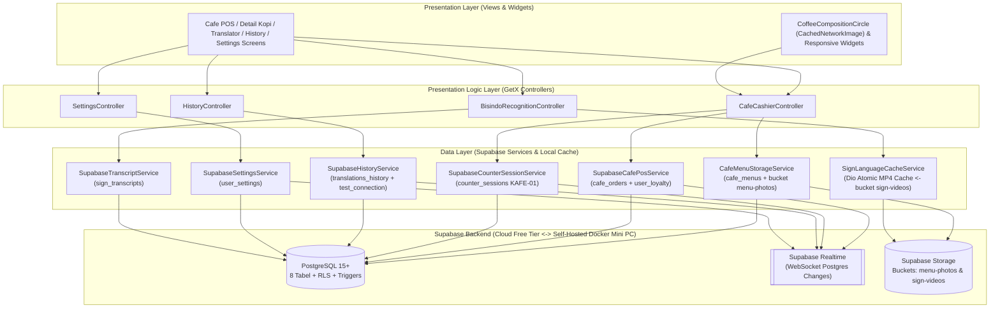

# Arsitektur Backend Supabase Sign2Speech (`speech2sign`) — Cloud-to-Local Ready

Dokumen ini merupakan panduan arsitektur resmi aplikasi **Sign2Speech (`speech2sign`)** berbasis **Supabase (PostgreSQL, Realtime, Storage)** dengan mempertahankan **Clean Architecture + GetX**, **Defensive Lazy Initialization**, dan **Dart 3 Sealed Class Result (`SupabaseResult<T>`)**.

Desain arsitektur ini **100% Cloud-to-Local Ready**: saat ini dikonfigurasi untuk **Supabase Cloud (Free Tier)** selama tahap pengembangan, dan dapat dipindahkan ke **Self-Hosted Supabase Docker di Mini PC Lokal (GEEKOM On-Premise)** hanya dengan mengganti **1 baris `supabaseUrl`** di [app_constants.dart](file:///c:/fadli/project/sign2speech/lib/core/constants/app_constants.dart) tanpa mengubah kode di Controller maupun UI.

---

## 1. Diagram Arsitektur Clean Architecture + GetX + Supabase



---

## 2. Struktur File & Pemetaan Arsitektur

| Komponen / Layer | File Proyek | Tanggung Jawab Utama |
| :--- | :--- | :--- |
| **Aturan Agent Supabase** | [.agents/rules/supabase-development-rules.md](file:///c:/fadli/project/sign2speech/.agents/rules/supabase-development-rules.md) | Kontrak arsitektur ketat: larangan impor `supabase_flutter` di UI, wajib Defensive Lazy Getter, wajib Sealed Class Result. |
| **Migrasi SQL & RLS** | [20261115000000_initial_sign2speech_schema.sql](file:///c:/fadli/project/sign2speech/supabase/migrations/20261115000000_initial_sign2speech_schema.sql) | DDL 8 tabel PostgreSQL, `CHECK` constraints, indeks performa, RLS policies, publikasi `supabase_realtime`, dan konfigurasi 2 public storage buckets (`menu-photos`, `sign-videos`). |
| **Konfigurasi Endpoint** | [app_constants.dart](file:///c:/fadli/project/sign2speech/lib/core/constants/app_constants.dart) | Single source of truth untuk `supabaseUrl`, `supabaseAnonKey`, `menuPhotosBucket`, `signVideosBucket`, dan URL katalog video isyarat. |
| **Bootstrap Non-Blocking** | [main.dart](file:///c:/fadli/project/sign2speech/lib/main.dart) | Inisialisasi `Supabase.initialize(...)` di dalam `try-catch` non-blocking agar aplikasi tetap berjalan lancar saat offline atau di lingkungan *widget test*. |
| **Sealed Class Result** | [supabase_result.dart](file:///c:/fadli/project/sign2speech/lib/core/supabase/supabase_result.dart) | Pemodelan hasil operasi (`SupabaseSuccess<T>` & `SupabaseFailure<T>`) untuk *exhaustive pattern matching* Dart 3. |
| **CRUD Menu & Foto Kopi** | [cafe_menu_storage_service.dart](file:///c:/fadli/project/sign2speech/lib/features/cafe_pos/data/datasources/cafe_menu_storage_service.dart) | Ambil foto (Kamera/Galeri), kompresi gambar (`flutter_image_compress` $\le 800\times 800\text{ px}$, kualitas $75\%$), upload ke bucket `menu-photos`, hapus foto lama otomatis, dan CRUD tabel `cafe_menus`. |
| **Order & Antrean POS** | [supabase_cafe_pos_service.dart](file:///c:/fadli/project/sign2speech/lib/features/cafe_pos/data/datasources/supabase_cafe_pos_service.dart) | Upsert tiket pesanan (`cafe_orders`), update status pesanan, *realtime stream* antrean aktif, dan sinkronisasi stempel loyalti (`user_loyalty`). |
| **Sinkronisasi 2-Tablet** | [supabase_counter_session_service.dart](file:///c:/fadli/project/sign2speech/lib/features/cafe_pos/data/datasources/supabase_counter_session_service.dart) | Sinkronisasi *stage* (`idle`, `ordering`, `naming`, `pickup`) dan *device pairing* (`KAFE-01`) antar tablet kasir dan pelanggan melalui tabel `counter_sessions`. |
| **Riwayat Terjemahan** | [supabase_history_service.dart](file:///c:/fadli/project/sign2speech/lib/features/history/services/supabase_history_service.dart) | Operasi simpan, ambil, hapus, dan *realtime stream* riwayat terjemahan (`translations_history`) serta uji koneksi (`test_connection`). |
| **Preferensi Pengguna** | [supabase_settings_service.dart](file:///c:/fadli/project/sign2speech/lib/features/settings/services/supabase_settings_service.dart) | Sinkronisasi peran (`deaf`, `hearing`, `cashier`), bahasa isyarat (`BISINDO`/`SIBI`), tema, serta kecepatan TTS & video (`user_settings`). |
| **Arsip Transkrip Isyarat** | [supabase_transcript_service.dart](file:///c:/fadli/project/sign2speech/lib/features/sign_language/services/supabase_transcript_service.dart) | Pengarsipan sesi token deteksi bahasa isyarat ke tabel `sign_transcripts`. |
| **Cache Video Isyarat** | [sign_language_cache_service.dart](file:///c:/fadli/project/sign2speech/lib/features/sign_language/services/sign_language_cache_service.dart) | Unduhan atomik file `.mp4` dari Supabase Storage bucket `sign-videos` dengan validasi *magic bytes* ISO-BMFF (`ftyp`). |

---

## 3. Skema Database PostgreSQL & Row Level Security (RLS)

Seluruh definisi skema terdapat di [20261115000000_initial_sign2speech_schema.sql](file:///c:/fadli/project/sign2speech/supabase/migrations/20261115000000_initial_sign2speech_schema.sql):

1. **`cafe_menus` (Tabel Baru — Katalog & Foto Menu Dinamis)**
   - Kolom: `id` (PK), `name`, `category` (`coffee`, `non_coffee`, `snack`), `price` ($\ge 0$), `description`, `image_url`, `image_path`, `sign_video_url`, `is_available`, `created_at`, `updated_at`.
   - Dilengkapi data *seed* awal 7 menu standar Sign2Speech.
2. **`cafe_orders` (Tiket & Antrean Pesanan POS)**
   - Kolom: `order_id` (PK), `queue_number`, `customer_name`, `customer_notes`, `items` (`JSONB`), `status`, `payment_method`, `amount_paid`, `subtotal`, `tax_amount`, `grand_total`, `change_amount`, `created_at`, `updated_at`.
3. **`counter_sessions` (Sinkronisasi Dual-Tablet Meja Kasir `KAFE-01`)**
   - Kolom: `counter_id` (PK), `stage` (`idle`, `ordering`, `naming`, `pickup`), `device_mode` (`singleTablet`, `dualTablet`, `singleTabletSwitch`, `singleTabletFlip`, `dualTabletLocked`), `current_order_id`, `cashier_tablet_id`, `customer_tablet_id`, `updated_at`.
   - **Keamanan RLS Dual-Tablet:** Memiliki RLS Policy yang secara eksplisit mengizinkan `SELECT`, `INSERT`, dan `UPDATE` dengan validasi skema ketat sehingga sinkronisasi 2 tablet kasir-pelanggan berjalan *real-time* tanpa terkena blokir `permission-denied`.
4. **`translations_history`**, **`user_settings`**, **`sign_transcripts`**, **`user_loyalty`**, dan **`test_connection`**.

---

## 4. Alur CRUD & Kompresi Foto Menu Kopi (`menu-photos`)

1. Kasir atau pengguna membuka halaman detail kopi ([coffee_detail_screen.dart](file:///c:/fadli/project/sign2speech/lib/features/cafe_pos/screens/coffee_detail_screen.dart)) lalu menekan tombol kamera ($\ge 48\times 48\text{ dp}$) pada lingkaran medali kopi ([coffee_composition_circle.dart](file:///c:/fadli/project/sign2speech/lib/features/cafe_pos/widgets/coffee_composition_circle.dart)).
2. Pengguna memilih sumber foto (**Ambil dari Kamera** atau **Pilih dari Galeri**).
3. `CafeMenuStorageService.pickAndCompressPhoto()` mengambil foto dan mengompresinya menggunakan `flutter_image_compress` ke ukuran maksimal **$800\times 800\text{ px}$ dengan kualitas $75\%$ JPEG** ($\approx 50\text{–}100\text{ KB}$) agar hemat kuota Supabase Cloud maupun disk Mini PC lokal.
4. Jika menu tersebut sebelumnya sudah memiliki foto di bucket (`oldStoragePath`), `CafeMenuStorageService.uploadMenuPhoto()` **menghapus file lama terlebih dahulu** (`bucket.remove([oldStoragePath])`) agar storage tidak penuh oleh file yatim (*orphan files*).
5. File baru diunggah ke bucket `menu-photos` pada path `menus/{menuId}_{timestamp}.jpg`, kemudian `image_url` dan `image_path` disimpan ke tabel PostgreSQL `cafe_menus`.
6. Widget `CoffeeCompositionCircle` otomatis merender foto dari `imageUrl` menggunakan `CachedNetworkImage` untuk performa *offline-first caching* yang instan.

---

## 5. Panduan 1-Langkah Migrasi dari Supabase Cloud ke Mini PC Lokal (GEEKOM Self-Hosted Docker)

Ketika Mini PC lokal (misalnya GEEKOM di jaringan LAN Kafe atau melalui Cloudflare Tunnel) sudah menjalankan **Supabase Self-Hosted Docker**, Anda **TIDAK PERLU** mengubah kode Controller, Service, maupun Widget.

Cukup pilih salah satu dari dua cara berikut:

### Cara A: Via `--dart-define` saat Build / Run (Direkomendasikan untuk Production CI/CD)
```bash
flutter run \
  --dart-define=SUPABASE_URL=http://192.168.1.100:8000 \
  --dart-define=SUPABASE_ANON_KEY=eyJhbGciOiJIUzI1NiIsInR5cCI6IkpXVCJ9...
```

### Cara B: Mengubah 1 Baris Default di `AppConstants` ([lib/core/constants/app_constants.dart](file:///c:/fadli/project/sign2speech/lib/core/constants/app_constants.dart))
```dart
static const String supabaseUrl = String.fromEnvironment(
  'SUPABASE_URL',
  defaultValue: 'http://192.168.1.100:8000', // <-- Ganti URL Cloud ke IP Mini PC GEEKOM / Domain Lokal
);
```

Seluruh endpoint REST PostgreSQL, WebSocket Realtime (`counter_sessions`, `cafe_orders`, `cafe_menus`), bucket `menu-photos`, dan bucket `sign-videos` (`catalog.json` & `*.mp4`) otomatis mengikuti `supabaseUrl` tersebut!
